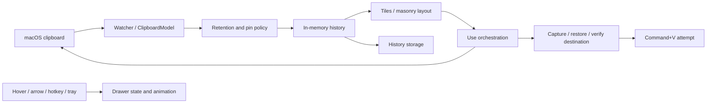

# nashclip architecture map and walkthrough

**Source checked:** 2026-10-11; source-formula packaging added 2026-11-17. See [project memory](project-memory.md) for chronology and current state, and [AGENTS.md](../AGENTS.md) for future-agent guidance.

## 1. Repository map

```text
mcopier/                         # checkout name; product branding is nashclip
├── AGENTS.md                    # handoff entry point and working guidance
├── README.md                    # product purpose, usage, limits, run commands
├── INSTALL.md, RELEASING.md      # user setup and maintainer publishing steps
├── CONTRIBUTING.md, SECURITY.md # contribution and vulnerability reporting
├── CHANGELOG.md                 # unreleased user-visible changes
├── LICENSE, NOTICE              # Apache 2.0; Avinash Kumar
├── .github/                     # CI, Dependabot, issue/PR templates
├── java-swing/
│   ├── src/*.java               # default-package application and services
│   ├── native/{focus,hotkey}.m   # JNI window identity and shortcut helper
│   ├── tests/                   # Swing controller/layout/interaction checks
│   ├── examples/                # learning-only LocalClipboardDemo
│   └── build.sh, run.sh, test.sh
├── java-fx/
│   ├── src/main/java/nashclip/  # JavaFX application and services
│   ├── src/main/resources/nashclip/style.css
│   ├── native/{focus,hotkey}.m
│   ├── tests/                   # FX clipboard/controller/geometry checks
│   └── pom.xml, run.sh, test.sh, maven-settings.xml
├── nashclip-swift/
│   ├── Sources/*.swift          # SwiftUI model/views, AppKit lifecycle/drawer
│   ├── Tests/*.swift            # storage/model/view/validation programs
│   ├── Package.swift, Info.plist
│   └── build.sh, run.sh, test.sh
├── tests/                       # shared Java programs and cross-version fixtures
│   ├── *.java, *.swift          # policy, persistence, lifecycle, native checks
│   ├── test_runner.py           # runner/coverage regression tests
│   ├── test_homebrew_package.py # packaging guards with mocked signing tools
│   └── coverage-policy.json     # thresholds
├── scripts/
│   ├── test.py                  # compile, run, isolate, report, cross-test
│   ├── coverage_tools.py        # JaCoCo/LLVM reports and gate checks
│   ├── setup-coverage.py        # verified test-tool download
│   ├── package-homebrew.py      # Swift ZIP, checksum, cask; preview/release modes
│   ├── check-homebrew-cask.rb    # real Homebrew DSL and checksum validation
│   ├── test-homebrew-cask.py     # positive controls and altered-cask rejection
│   ├── mutation-checks.py       # selected faults in temporary source copies
│   └── audit-checks.py, gui-checks.py  # earlier grouped harnesses
├── docs/                        # architecture, memory, testing, audit, verdict
└── test-results/                # generated local evidence, not production data
```

Build outputs include Swing `out/`, JavaFX `target/`, Swift `build/` and `.build/`, native executables/libraries, and `.test-tools/`. Edit source and rebuild; avoid hand-editing generated binaries.

`Formula/nashclip.rb` makes this repository a personal Homebrew source tap. It
downloads a checksum-pinned public source commit and calls the Swift build
script on the installing Mac. The locally signed app goes under formula
`libexec`; `bin/nashclip` launches it using a stable Homebrew opt path. This
route needs Command Line Tools and does not use the binary cask packager.
See [the source formula guide](../homebrew/README.md).

Homebrew packaging outputs belong in ignored `dist/`. The packager consumes an existing Swift bundle; it does not compile, sign, notarize, install, or publish it. Release mode verifies distribution prerequisites before producing a cask, while preview mode emits a labelled draft. See the [Homebrew guide](homebrew.md) for the complete publishing sequence.

## 2. Separation of responsibilities



The app controller connects services. Storage handles formats and filesystem errors. History policy defines what can be retained. Views present state and dispatch actions. Drawer controllers own geometry, transitions, and input state. Native paste and hotkeys cross the OS boundary. Keeping these boundaries visible is the mental model the user wanted to learn.

## 3. Class/file map

Paths in the Java columns are relative to `java-swing/src/` and `java-fx/src/main/java/nashclip/`; Swift names are relative to `nashclip-swift/Sources/`.

| Responsibility | Swing | JavaFX | Swift |
| --- | --- | --- | --- |
| Entry | `Main.java` | `Launcher.java` | `Main.swift` / `NashClipMain` |
| App wiring, tray, dialogs, Use | `NashClip.java` | `NashClipApp.java` | `AppController.swift` |
| Capture and copy | `ClipboardWatcher.java` | `ClipboardWatcher.java` | `ClipboardModel.swift` |
| History model | `DefaultListModel<String>` in controller | `ObservableList<String>` in controller | Published `Clip` array and pinned text |
| Tile layout | `HistoryGrid.java` | `HistoryGrid.java` | `Views.swift` / `CopierView.masonryColumns` |
| Tile appearance | `NashClip.createHistoryTile`, `ClipboardTheme.java` | `ClipboardTile.java`, CSS | `Views.swift` |
| Drawer/drag/resize | `EdgeDrawer.java` | `EdgeDrawer.java` | `DrawerController.swift` |
| Settings | `AppSettings.java` | `AppSettings.java` | `Storage.swift` / `CopierSettings` |
| Size storage | `WindowSizeStore.java` | `WindowSizeStore.java` | `Storage.swift` / `WindowSize` |
| Position storage | Not persisted | `DrawerPositionStore.java` | `Storage.swift` / `DrawerPosition` |
| History formats | `HistoryStore.java` | `HistoryStore.java` | `Storage.swift` / `CopierStorage`, `JavaProperties` |
| Bounds/identity | `HistoryPolicy.java` | `HistoryPolicy.java` | `HistoryPolicy.swift` |
| Oversize notice | `RejectedClipTracker.java`, `SizeNotice.java` | Same class names | `RejectedClip` in model; notice in `Views.swift` |
| Legacy migration | `DataDirectory.java` | `DataDirectory.java` | `CopierStorage.preferredDirectory` |
| Single instance | `InstanceLock.java` | `InstanceLock.java` | `InstanceLock.swift` |
| Shortcut | `GlobalHotkey.java` + native helper | Same | `GlobalHotkey.swift` / Carbon |
| Paste coordination | `PasteService.java` | `PasteService.java` | `PasteCoordinator.swift` |
| Window identity | `NativeFocus.java` + `native/focus.m` | Same, with package-aware JNI names | AX APIs in `PasteCoordinator.swift` |

`CommandRunner.java` remains tested but is no longer used for periodic Java paste/focus tracking. Its subprocess descriptor tests do not measure JNI allocations.

## 4. Walk through a copied clip

1. Startup acquires the shared instance lock, loads settings/history/geometry, assembles the UI, and starts services.
2. The watcher records a startup baseline. A one-second poll detects later changes; paused/stopped states reject capture.
3. Busy/unavailable clipboard reads preserve observation state or retry. Swift also checks that the pasteboard change counter did not move during reading.
4. Policy rejects blank/oversized content. Oversized text creates size metadata for the notice; it does not create a history tile.
5. Own copies and repeated observations are suppressed. A copied pinned clip does not create another ordinary tile.
6. New ordinary text is placed at the front of ordinary history. Pins remain first. Limits trim older ordinary entries and preserve the total text budget.
7. The history view updates and storage persists the snapshot. Capture-originated write failures can leave changes in memory with an error status; pin/delete actions use save-before-commit behavior to avoid falsely showing a successful persistent change.

**Threading today:** Swing callbacks run on the EDT; JavaFX callbacks on the FX application thread; Swift model operations on the main actor. Serialization and disk writes still occur synchronously in these paths. A future background writer must preserve ordering, error visibility, and shutdown semantics rather than starting an unbounded thread per copy.

## 5. Walk through Use

### Java

1. The controller checks its stopped/single-flight state and asks the watcher to copy the full text. A failed clipboard write stops the operation.
2. A background worker remembers the frontmost external application/window and freezes a native target token.
3. The drawer hides. Swing uses immediate hide in its Use path; JavaFX waits for an accepted close completion. Busy/refused transitions release the pending operation.
4. `PasteService` validates expected clipboard text, restores the frozen window, waits for restoration, and rechecks cancellation, exact window identity, and clipboard text.
5. The platform adapter sends Command+V. Java releases modifier/key state through `finally` cleanup. Target references are released on success/failure/cancellation.
6. UI completion clears the busy flag and shows status. Failed paste keeps the clip available for manual Command+V.

`NativeFocus` serializes JNI access and disposal. `native/focus.m` retains/releases AX references and rejects missing, terminated, untrusted, or mismatched targets. `PasteService.PlatformAccess` allows decision tests without activating apps or sending keys.

### Swift

1. `AppController.use` sets a single-flight flag and asks `PasteCoordinator.captureFrontmost` to refresh the destination.
2. `ClipboardModel.copy` writes to the pasteboard and updates its observation baseline to suppress recapture.
3. The controller freezes `PasteCoordinator.Target` and the pasteboard change count **before** the closing animation.
4. `DrawerController.hide` accepts a completion or refuses a busy transition. Completion invokes `PasteCoordinator.paste` with the frozen destination.
5. Paste checks target/window availability, expected clipboard state, Accessibility trust, and destination process availability; then it activates/raises the destination.
6. Delayed work checks its generation token, frontmost PID, exact AX window, and clipboard state before creating and posting Command+V events.
7. Completion clears the Use flag, updates status, and reopens for failure or drawer pinning. Stop cancels pending work and removes the workspace observer.

**Current diagnosis:** the trust check follows the missing-window guard. With nashclip Accessibility OFF, capture may have no AX window, so the user can receive an unhelpful verification message before the permission-specific message. This ordering was observed, not yet changed. Resolve permission first and verify the actual failure path before rewriting restoration logic.

Neither implementation verifies that a particular editable field accepted the event; focus and clipboard checks cannot be atomic with external event delivery.

## 6. Walk through the drawer

Drawer state includes open/closed, pinned, clicked-inside, modal interaction, dragging, resizing, hover suppression, pending close completion, and animation state/token.

| Input/state | Intended result |
| --- | --- |
| Short hover followed by exit before delay | Cancel opening. |
| Sustained hover, hotkey, or Show | Open smoothly. |
| Pointer exits an open drawer | Keep it open. |
| Outside click before an inside click, unpinned | Close. |
| Inside click | Latch open against subsequent outside dismissal. |
| Drawer pin | Keep open; persisted setting. |
| Arrow / Hide | Explicit dismissal; capture continues. |
| Header or handle drag | Move and dock near the chosen screen edge. |
| Resize | Use the inner side edge or top/bottom, clamp dimensions, save on completion. |
| Modal dialog | Prevent conflicting movement/dismissal during interaction. |
| Quit/dispose | Stop timers/animations and callbacks; do not recreate windows afterward. |

Pay particular attention to resize during close: an accepted completion must run exactly once or be explicitly cancelled on disposal. Earlier bugs here could leave Use busy forever.

Masonry tracks accumulated column height and inserts each tile into the shortest stack. It is not a strict row grid or round-robin distribution. Width changes can reduce three columns to two or one. Reading order across uneven columns is a presentation choice; history order remains in the model.

## 7. Persistence and interoperability

Normal data directory: `~/.nashclip`. Swift supports `NASHCLIP_DATA_DIR`; Java tests use a temporary `user.home`. Do not assume the Swift environment override redirects Java production storage.

| File | Contract |
| --- | --- |
| `settings.json` | `historyLimit`, drawer `pinned`, `theme`, `sizeNoticeSeconds`. |
| `history.properties` | Version 2: `version`, ordinary `count`/`entry.N`, `pinned.count`/`pinned.N`. Version 1 remains readable. |
| `window-size.properties` | `width`, `height`, `defaultWidth`, `defaultHeight`. |
| `java-fx-position.properties` | JavaFX placement. |
| `swift-position.json` | Swift screen bounds, side, and vertical fraction. |
| `instance.lock` | Persistent inode with a process-owned POSIX record lock. |

Example defaults:

```json
{"historyLimit":40,"pinned":false,"theme":"light","sizeNoticeSeconds":4}
```

Both Java variants and Swift use exact text identity consistent with UTF-16. Swift's normal canonical-equivalence string comparison cannot replace the deliberate exact comparison for clip identity. Preserve Java-properties escapes and cross-language fixtures when changing serialization.

Writes use private temporary files and replacement; validate before writing. Keep corrupt/unreadable files intact, report failure, and pause automatic history writes where startup load failed. Preserve legacy migration data. The lock file is not a stale-marker file to delete; the OS owns lock lifetime. Swift `lockf` behavior is process-scoped, so cross-process tests are authoritative for interoperability.

## 8. Native integration and lifetime

Java native hotkey helpers register the shortcut and emit events over a subprocess protocol. `GlobalHotkey` parses those events, reports startup/errors, and cleans up the process/streams on close. UI callbacks return to the toolkit thread.

Swift registers a Carbon hotkey with an event-handler token and unregisters it on stop. `AppController` owns tray items, local/global click monitors, model, paste coordinator, and drawer. Termination closes these services and releases the instance lock.

Accessibility permission is per authorized application/process identity. `java` ON does not mean `nashclip` ON. Never infer a permission state from successful compilation, an empty log, or an unrelated app's permission.

## 9. Test map and change guide

| Change | Start here | Relevant verification |
| --- | --- | --- |
| Capture/pause/dedup | Watchers or Swift model | `ClipboardWatcherChecks`, `FxClipboardTests`, `ModelFeatureTests`, `SwiftLifecycleChecks` |
| Limits/pins/encoding | History policy and storage in all variants | `AuditChecks`, `SettingsPolicyTests`, `DataValidationTests`, `StorageChecks`, `StorageFeatureTests`, `StorageValidationTests`, cross-version suite |
| Use/focus/cancellation | Controller + paste coordinator + native adapter | `PasteServiceTests`, feature Use tests, `NativeFocusChecks`; controlled native acceptance still required |
| Drawer dismissal/animation | Drawer controller | `SwingDrawerChecks`, `DrawerChecks`, `SwiftDrawerChecks`, interaction/view tests |
| Styling/masonry | Theme/CSS/tile/view/layout | Java feature tests, `ViewDrawerFeatureTests`, visual check |
| Settings/geometry | Settings/size/position store and dialog | Shared settings tests, `PositionTests`, Swift storage tests, modal acceptance |
| Native hotkey | Java helper/adapter or Swift Carbon service | `HotkeyProtocolTests`; actual registration/conflict/release acceptance |
| Harness/coverage | `scripts/test.py`, `coverage_tools.py` | `python3 tests/test_runner.py`, complete coverage run when relevant |
| Packaging | Build/run scripts, POM, Info.plist | Build actual artifacts, inspect signatures/contents, clean install |

The Java shared test programs are copied into a temporary build; the runner supplies the JavaFX package declaration. Swift test programs have their own `@main` entry points and compile with selected real production files. `Package.swift` currently defines the executable; these tests are driven by `scripts/test.py`, not an established SwiftPM test target.

The suite deliberately isolates data/clipboard effects. It does not launch the complete real app stack for every controller fixture. Coverage includes unexecuted startup code, making those gaps visible. Use [docs/testing.md](testing.md) for exact run options and [docs/project-memory.md](project-memory.md) for dated results.

## 10. Suggested reading order for the learner

1. Read `HistoryPolicy` and a small policy test: identify a rule and its observable result.
2. Read one watcher: identify observation state, startup baseline, pause, and callbacks.
3. Follow the controller's new-text callback into the model, view refresh, and storage write.
4. Read `HistoryGrid` or `masonryColumns`: trace A/B/C/D through the shortest-column decision.
5. Follow a Use action through clipboard copy, frozen destination, drawer completion, verification, and cleanup.
6. Read drawer state transitions separately from animation math; explain why latching and pending completions matter.
7. Compare storage/locking across Java and Swift and inspect a disposable version-2 fixture.
8. Finally read startup/quit wiring and list every resource that must be stopped or released.

For each change, ask: who owns this state, which thread may mutate it, what happens if the operation fails, and who cleans it up? Those four questions connect the separated components into a reliable application.
